<h1>  <sub>for iOS</sub></h1>

An iPhone music player for your own collection.

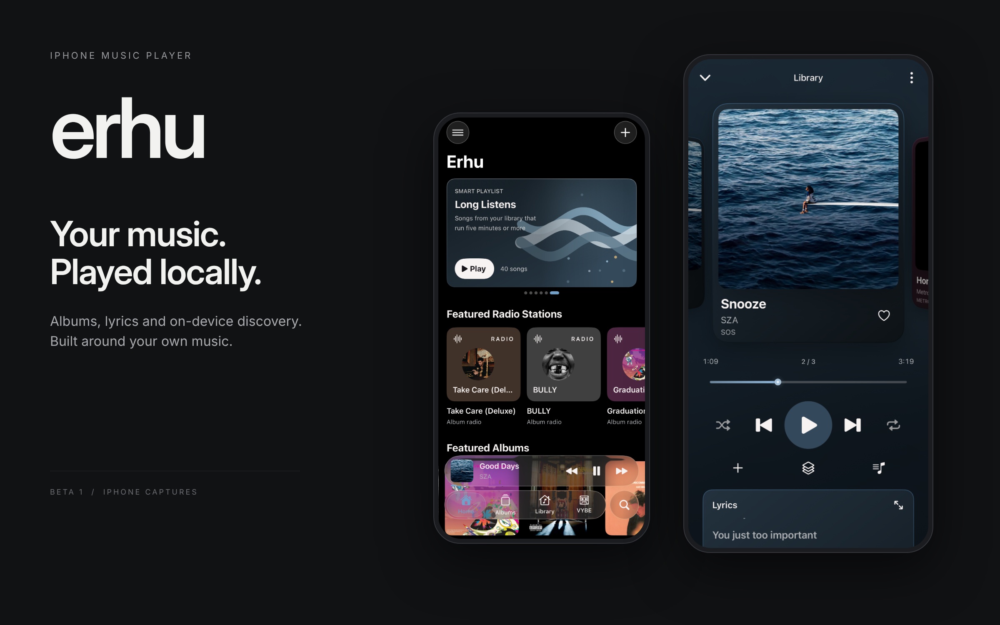

## Beta 1

The first beta is available as an unsigned IPA for iOS 17 and newer, installed with your own Apple ID through a sideloading tool. Compatibility with other iPhones and iOS versions is still being tested.

It comes in two variants:

| Build | What it adds | Download |
| --- | --- | --- |
| **Static artwork** | The full app with still album covers | [Download IPA](https://github.com/MeezaUni/Erhu-iOS/releases/download/v1.0-beta/Erhu-v1.0-beta-static.ipa) |
| **Animated artwork** | Everything above, plus downloaded animated album covers in the app and on the Lock Screen | [Download IPA](https://github.com/MeezaUni/Erhu-iOS/releases/download/v1.0-beta/Erhu-v1.0-beta-animated.ipa) |

[Release notes](https://github.com/MeezaUni/Erhu-iOS/releases/tag/v1.0-beta) · Newer development builds: [Static](https://github.com/MeezaUni/Erhu-iOS/actions?query=workflow%3AiOS+branch%3Awithout-animated-art) · [Animated](https://github.com/MeezaUni/Erhu-iOS/actions?query=workflow%3AiOS+branch%3Awith-animated-art) (open a successful run and download **Erhu-ipa**)

Install the IPA with [SideStore](https://sidestore.io/) or [AltStore Classic](https://altstore.io/), then add music with **+**, the Files app or **Wi-Fi Transfer**. erhu plays music stored on your iPhone; radio stations and smart playlists select tracks from your own library.

With a free Apple ID, refresh the app within **7 days**; the usual limit of **3 active apps** includes your installer. Installing a newer IPA over the existing app keeps your library, settings, favourites and listening history. See the [installation guide](docs/INSTALLING.md).

## Features

- Albums, artists, playlists, favourites, listening history and listening stats.
- Smart playlists and radio stations generated from your library.
- Songs filtered by genre and mood: Chill, High energy, Late night, Feel-good, Party, Love songs, Sad & reflective, Dark, Focus and Throwback.
- On-device VYBE search by mood, artist or song, built into the app.
- Synced lyrics from embedded lyrics, LRC files, cached results and LRCLIB, with offline downloads.
- Queue management, A–B loops, bookmarks, Auto Fix Tags with review and Revert, and online or local artwork.
- Higher-resolution cover and artist-photo upgrades, checked against your current image before saving.
- Transition Studio with album, playlist and track-pair crossfades and editable curves.
- 8-band equalizer with presets, and a visualizer.
- Artwork-coloured themes, light, dark and system appearance, and imported theme packages.
- Swipeable cover carousel in Now Playing and a floating glass mini-player.
- Animated album covers in the app and on the Lock Screen (animated-artwork build only).
- Wi-Fi Transfer from a computer's browser, and manual and automatic update checks for new releases.

MP3, AAC, ALAC, FLAC, WAV, AIFF, CAF and Ogg Vorbis/Opus are supported, in M4A, M4B and MP4 containers where applicable. Protected (DRM) files are not.

## Screenshots

Captured on an iPhone from the current build. They show the real interfaces.

### Home and discovery

<table>
  <tr>
    <th width="33%">Home</th>
    <th width="33%">Radio stations</th>
    <th width="33%">VYBE</th>
  </tr>
  <tr>
    <td><a href="images/showcase/home.png">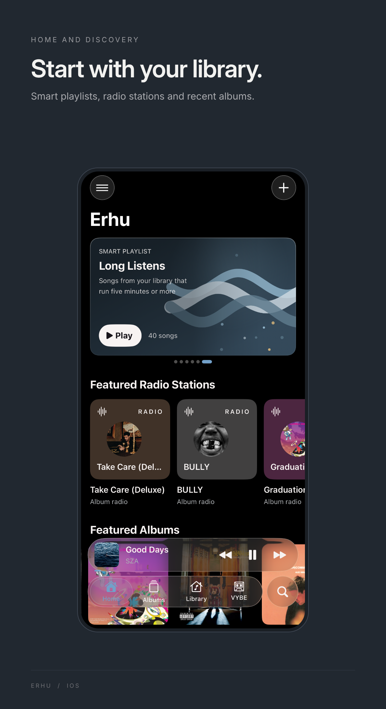</a></td>
    <td><a href="images/showcase/radio.png">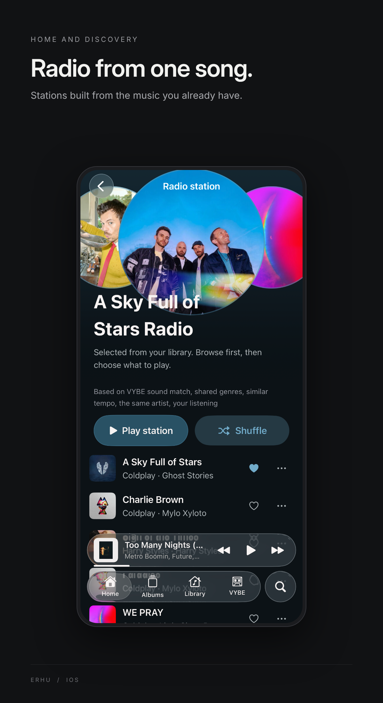</a></td>
    <td><a href="images/showcase/vybe.png">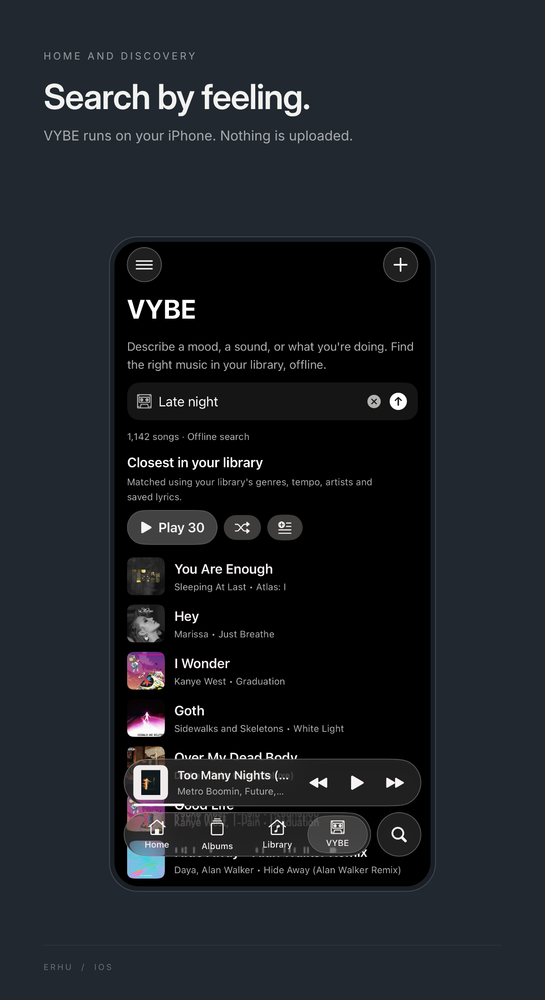</a></td>
  </tr>
</table>

[See the radio, featured-album and recently-played shelves](images/showcase/home-discovery.png).

### The listening experience

<table>
  <tr>
    <th width="33%">Now Playing</th>
    <th width="33%">Synced lyrics</th>
    <th width="33%">Queue</th>
  </tr>
  <tr>
    <td><a href="images/showcase/now-playing.png">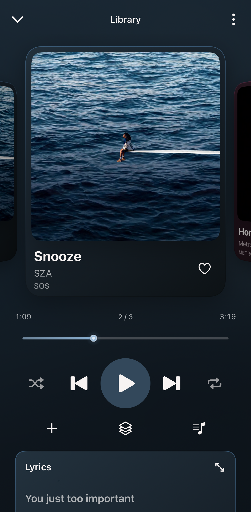</a></td>
    <td><a href="images/showcase/lyrics.png">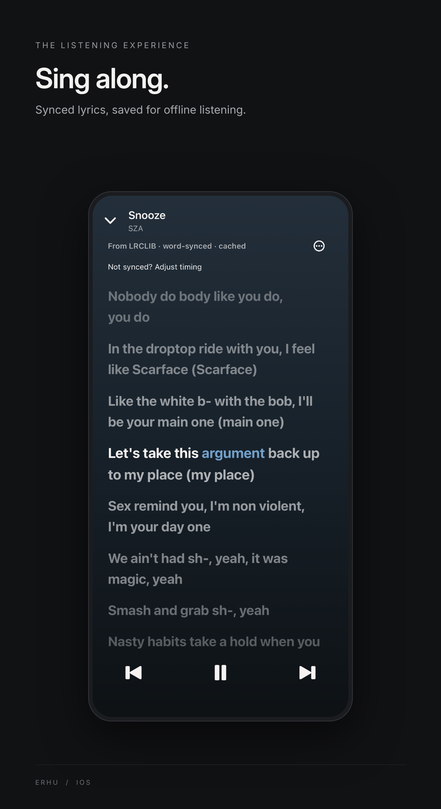</a></td>
    <td><a href="images/showcase/queue.png">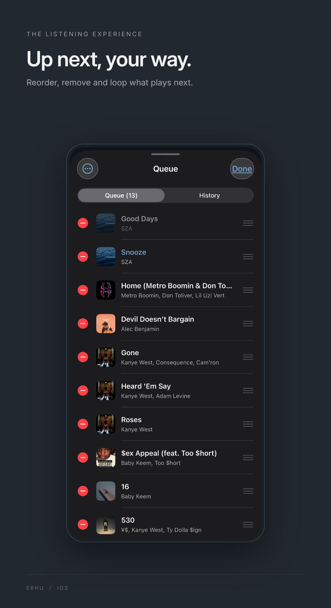</a></td>
  </tr>
</table>

### Your library and audio controls

<table>
  <tr>
    <th width="33%">Library</th>
    <th width="33%">Songs and moods</th>
    <th width="33%">Equalizer</th>
  </tr>
  <tr>
    <td><a href="images/showcase/library.png">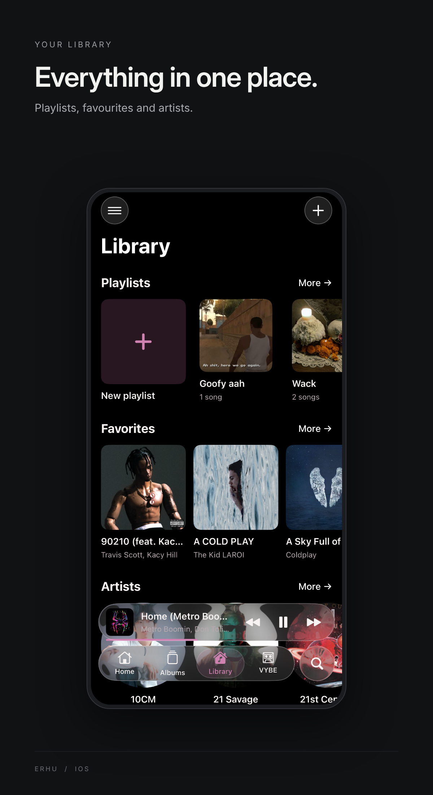</a></td>
    <td><a href="images/showcase/songs-moods.png">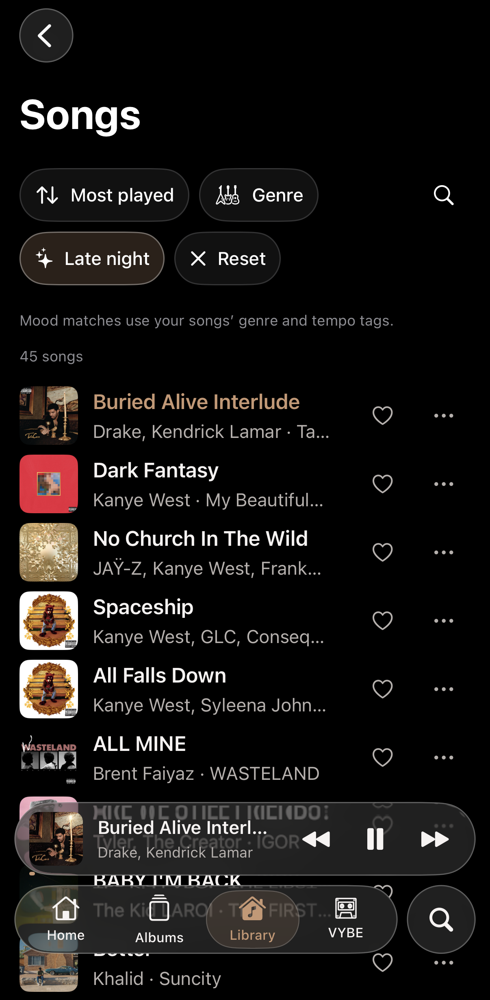</a></td>
    <td><a href="images/showcase/equalizer.png">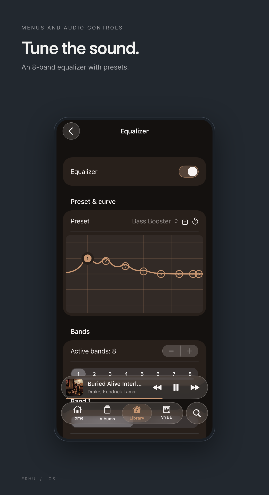</a></td>
  </tr>
</table>

<details>
  <summary>Floating album controls</summary>
  <p>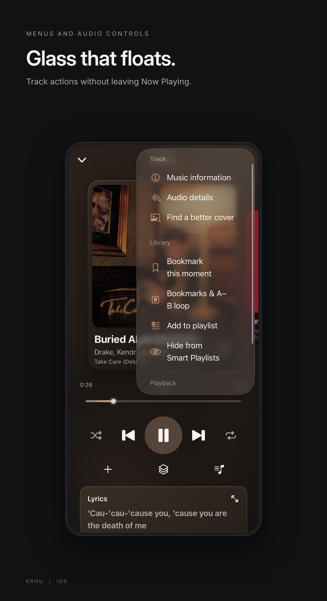</p>
</details>

### Library tools

<table>
  <tr>
    <th width="33%">Artwork Fetcher</th>
    <th width="33%">Upgrade covers</th>
    <th width="33%">Auto Fix Tags</th>
  </tr>
  <tr>
    <td><a href="images/showcase/artwork-fetcher.png">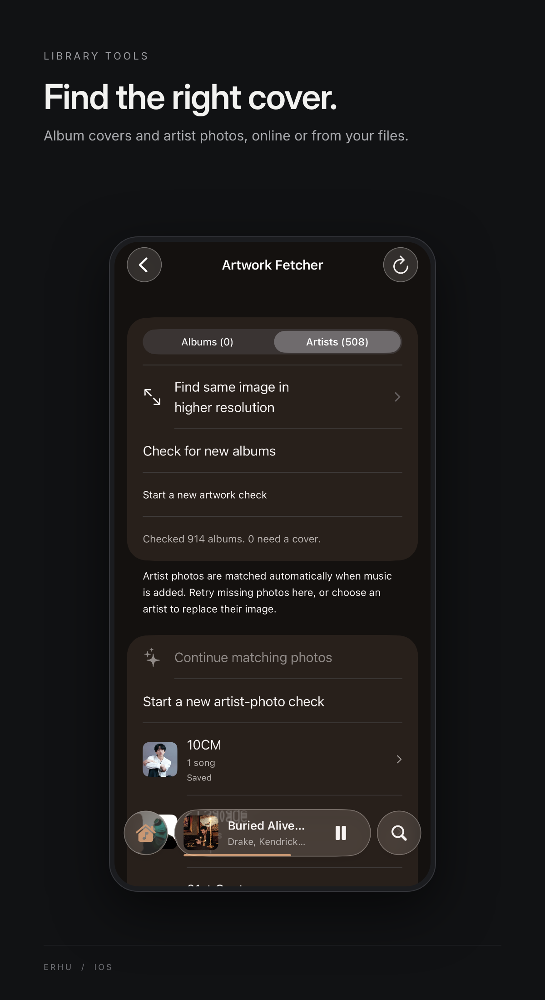</a></td>
    <td><a href="images/showcase/artwork-upgrade.png">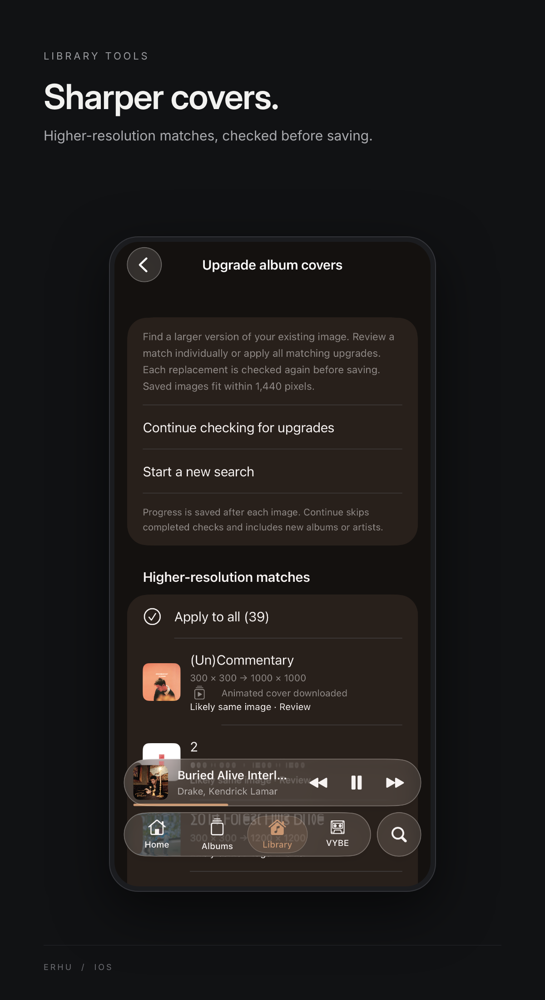</a></td>
    <td><a href="images/showcase/auto-fix-tags.png">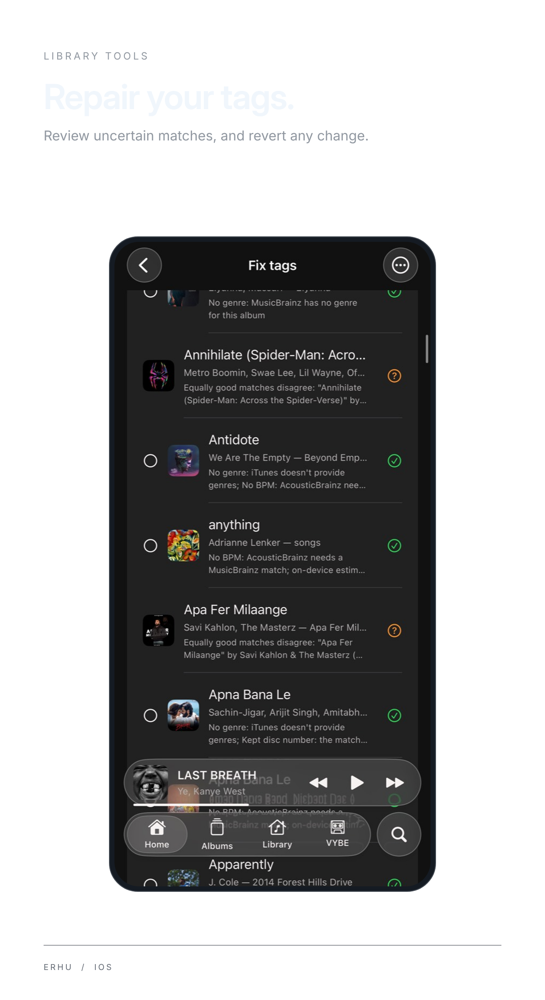</a></td>
  </tr>
</table>

- **Artwork Fetcher:** find album covers and artist photos, inspect candidates and apply your selection. Album menus also accept an image from Photos or Files.
- **Upgrade covers:** search for larger versions of your current covers and artist photos. Review each match or apply them all; every replacement is checked again before saving. In the animated-artwork build, albums with a downloaded animated cover are marked and can be skipped.
- **Auto Fix Tags:** add tracks, albums or artists to a repair queue, choose the metadata fields to change, and review uncertain matches. The original file is kept so every change can be reverted.

### Transition Studio

Choose how an album or playlist crossfades, or edit a single track pair. Shape the volume, EQ and filter curves over the source waveforms, preview the transition, then save it.

<table>
  <tr>
    <th width="50%">Album and playlist transitions</th>
    <th width="50%">Track-pair editor</th>
  </tr>
  <tr>
    <td><a href="images/showcase/transition-studio.png">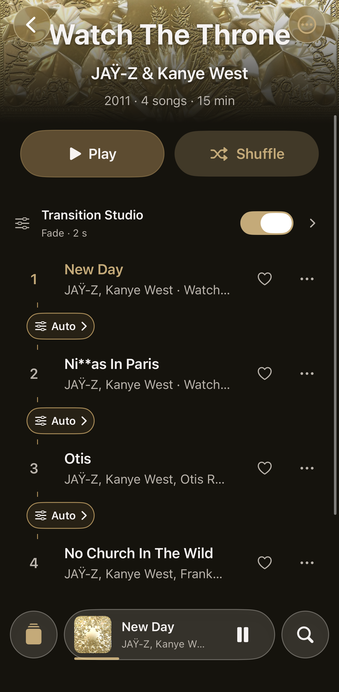</a></td>
    <td><a href="images/showcase/transition-editor.png">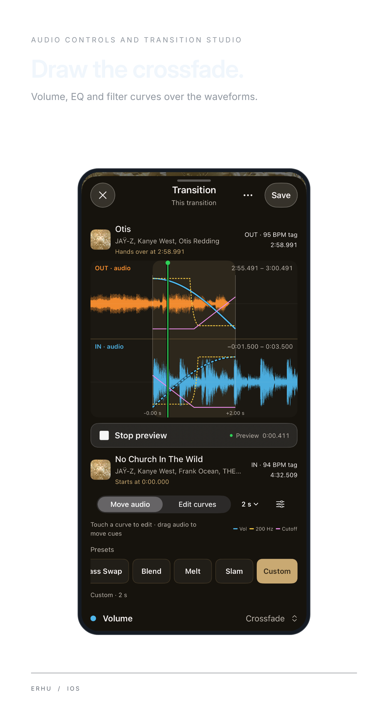</a></td>
  </tr>
</table>

[Album order and transitions](docs/ALBUM_ORDER_AND_TRANSITIONS.md)

The in-app introduction covers these tools. Reopen it from **Settings → About Erhu → Introduction**.

### Animated artwork on the Lock Screen

**Animated-artwork build only.** Downloaded animated covers play in Now Playing and, on iOS 26 and newer, on the Lock Screen. iOS decides when the Lock Screen shows the animation.


[How animated covers work](https://github.com/MeezaUni/Erhu-iOS/blob/with-animated-art/docs/ANIMATED_COVERS.md)

## VYBE

VYBE searches your library using descriptions of what you want to hear, such as a mood, an artist or a song you like. It runs entirely on your iPhone; nothing is uploaded and there is no cloud inference.

On iOS, VYBE's model is built into the app (a compressed Core ML MiniLM, about 17 MB), so there is nothing to download. Turn it on during the introduction or in Settings, then leave the app open while it indexes your library. See [VYBE details](docs/VYBE.md).

## Build

erhu for iOS uses Swift, SwiftUI, AVFoundation and Core Audio.

On a Mac with Xcode and [XcodeGen](https://github.com/yonaskolb/XcodeGen):

```sh
xcodegen generate
open Erhu.xcodeproj
```

The [iOS workflow](.github/workflows/ios.yml) builds an unsigned IPA and runs the native interaction checks and unit tests on a simulator for both artwork branches. See [Build from source](docs/BUILDING.md).

`without-animated-art` is the default branch and builds the static-artwork variant; `with-animated-art` builds the animated variant. Shared changes are kept in sync on both.

## Feedback

Report bugs through [GitHub Issues](https://github.com/MeezaUni/Erhu-iOS/issues). Include your iPhone model, iOS version, app version, artwork variant and steps to reproduce the problem.

[Contributing](CONTRIBUTING.md) · [Security policy](SECURITY.md) · [Code of conduct](CODE_OF_CONDUCT.md)

## Contributors

- [Mohammed Azeem](https://github.com/MeezaUni) (iOS)
- [Lochan Thakke](https://github.com/lochanpthakke) and [Kshitij Kekunnaya](https://github.com/Kshitij1425), authors of [erhu for Android](https://github.com/lochanpthakke/erhu)

## License

[GNU General Public License v3.0](LICENSE). Shared Android code and branding are documented in the [third-party notice](ThirdParty/ANDROID-NOTICE.md).
