# Erhu for iOS 

**Why Erhu?** A native iPhone music player for your own files, with offline discovery, custom transitions, and artwork-based themes. No Erhu account or music subscription required. Free to sideload on iOS 17+.

<table>
  <tr>
    <th width="50%" align="left">Design &amp; UI</th>
    <th width="50%" align="left">Audio formats &amp; engine</th>
  </tr>
  <tr>
    <td width="50%" valign="top">
      <ul>
        <li>Native SwiftUI, artwork carousel, and mini-player.</li>
        <li>Artwork colours, light/dark/system appearance, and imported themes.</li>
        <li>Downloaded video covers; offline after saving (animated-art build).</li>
        <li>Lock Screen animation: iOS 26+, controlled by iOS.</li>
      </ul>
    </td>
    <td width="50%" valign="top">
      <ul>
        <li>MP3, AAC, ALAC, FLAC, WAV/WAVE, AIFF/AIF/AIFC, and CAF.</li>
        <li>M4A, M4B, and MP4 containers; unprotected files with iOS-supported codecs.</li>
        <li>Dual-deck AVAudioEngine with Core Audio decoding.</li>
        <li>Custom EQ/transition Audio Units, gapless scheduling for matching formats, and timed crossfades.</li>
      </ul>
    </td>
  </tr>
</table>

<table>
  <tr>
    <th width="50%" align="left">Features &amp; tools</th>
    <th width="50%" align="left">Privacy &amp; data</th>
  </tr>
  <tr>
    <td width="50%" valign="top">
      <ul>
        <li><strong>Playback:</strong> queue, shuffle, repeat, background/headphone/Lock Screen controls, waveform seeking, A–B loops, and bookmarks.</li>
        <li><strong>Sound &amp; transitions:</strong> 8-band EQ, presets, visualizer, and album/playlist/song-pair transitions with editable curves.</li>
        <li><strong>Library &amp; discovery:</strong> albums, artists, playlists, favorites, search, smart mixes, radio, and listening stats.</li>
        <li><strong>VYBE:</strong> offline mood/name searches, multiple references, artist aliases, and BPM/year filters.</li>
        <li><strong>Synced lyrics:</strong> embedded lyrics, LRC/enhanced LRC, online lookup, and word timing when available.</li>
        <li><strong>Tools:</strong> Files/Wi-Fi import, tag editing, metadata matching, artwork/artist images, and BPM lookup or estimation.</li>
      </ul>
    </td>
    <td width="50%" valign="top">
      <ul>
        <li>Audio files and library data stay on your device.</li>
        <li>On-device VYBE; no cloud inference.</li>
        <li>Online lyrics/artwork/metadata providers receive search metadata.</li>
        <li>Personal API keys are stored in the device Keychain.</li>
      </ul>
    </td>
  </tr>
</table>

## Screenshots

  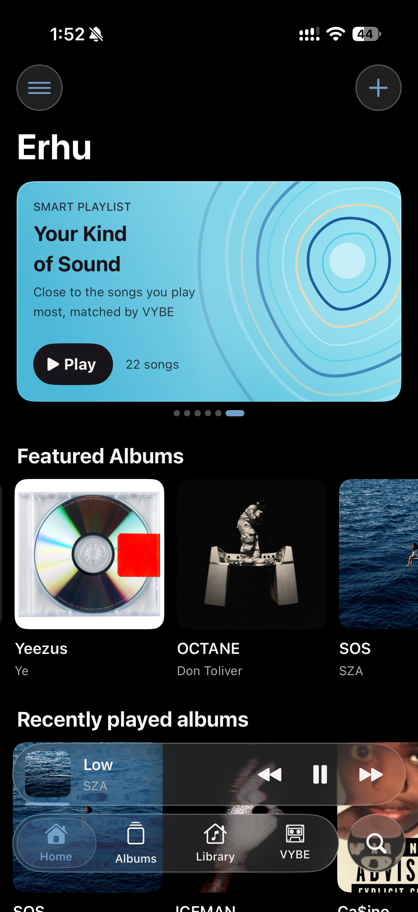
  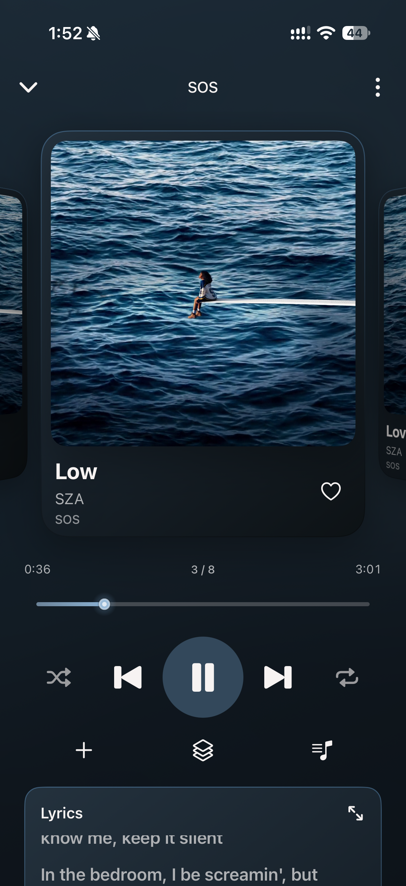
  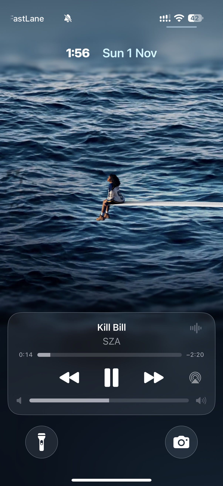
  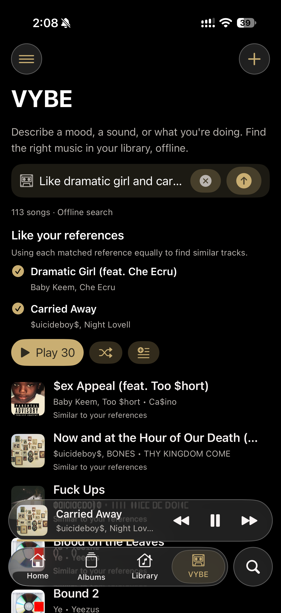
   
  Home · Now Playing · Lock Screen · VYBE

  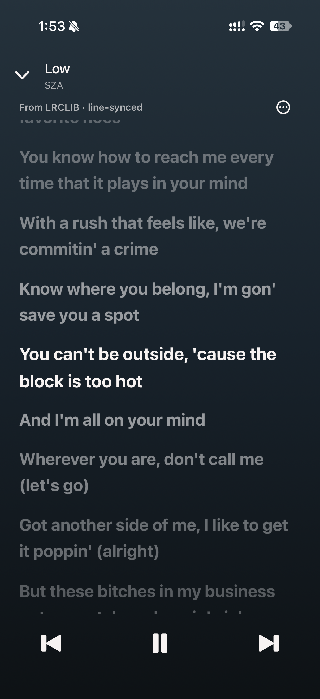
  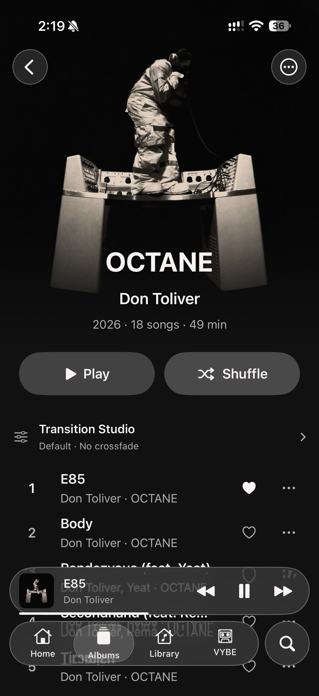
  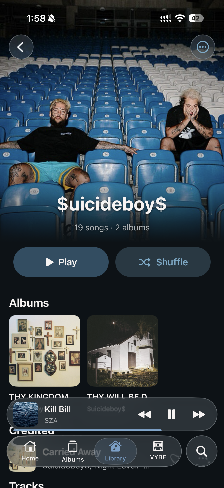
  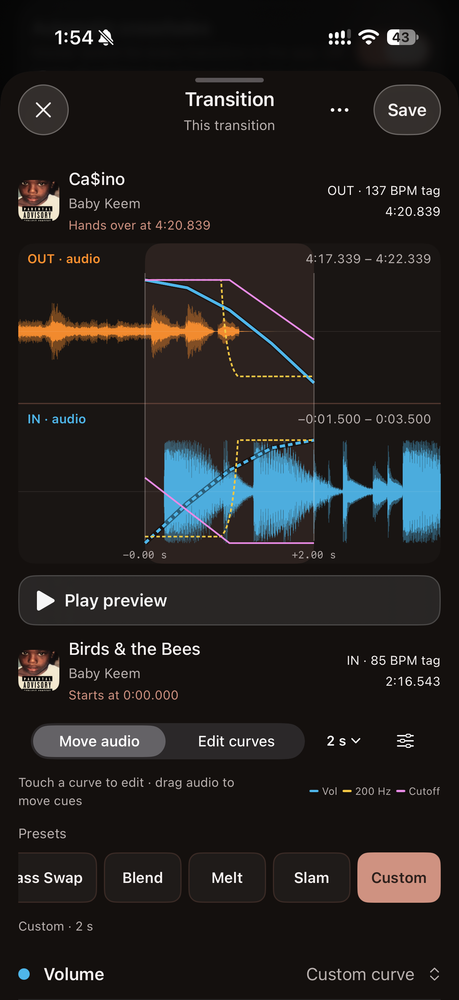
   
  Lyrics · Album · Artist · Transition Studio

More screens: library, themes, visualizer, equalizer, lyrics, and track menu

  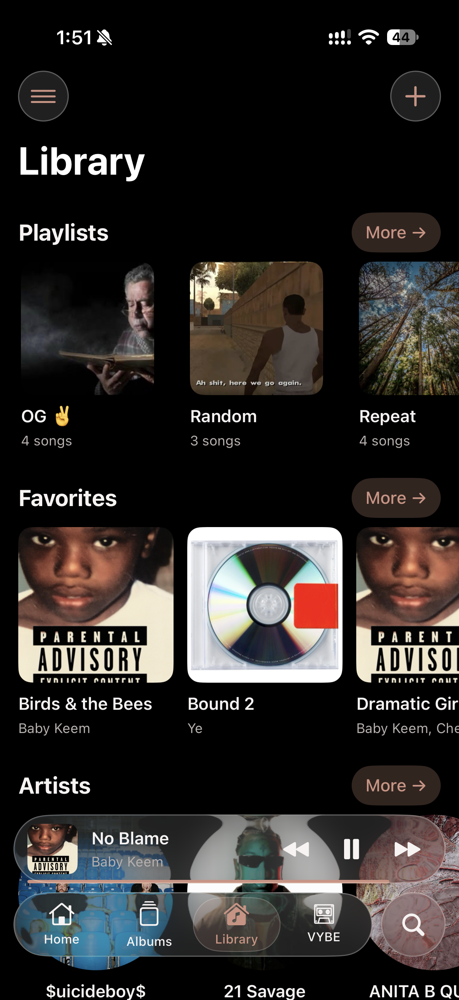
  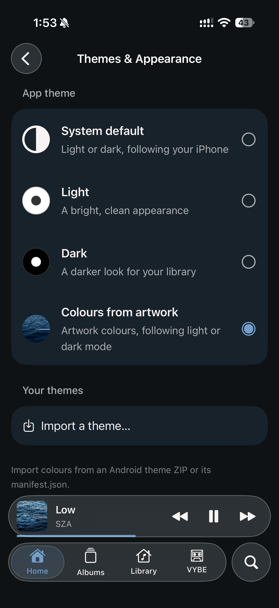
  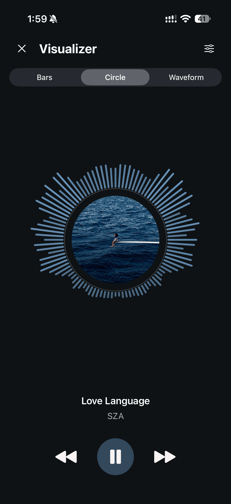
   
  Library · Themes &amp; Settings · Visualizer

  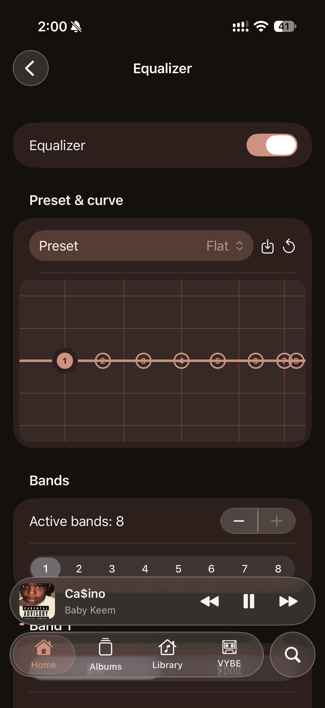
  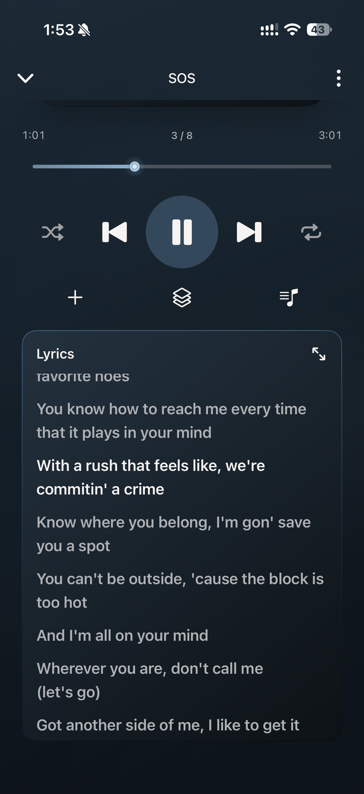
  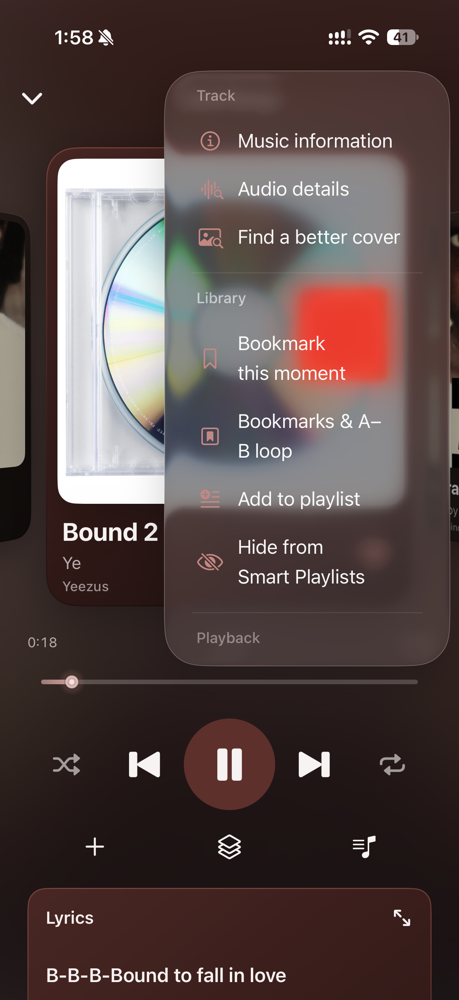
   
  Equalizer · Player Lyrics · Track Menu

## Install

| Build | Download |
| --- | --- |
| Static artwork | [Download IPA](https://github.com/MeezaUni/Erhu-iOS/releases/download/v1.0-beta/Erhu-v1.0-beta-static.ipa) |
| Animated artwork | [Download IPA](https://github.com/MeezaUni/Erhu-iOS/releases/download/v1.0-beta/Erhu-v1.0-beta-animated.ipa) |

1. Download the IPA for your chosen variant above, or open the [v1.0-beta release](https://github.com/MeezaUni/Erhu-iOS/releases/tag/v1.0-beta).
2. Install it with [SideStore](https://sidestore.io/) or [AltStore Classic](https://altstore.io/).
3. Import music with **+**, the Files app, or **Wi-Fi Transfer**.

Free Apple ID: refresh within **7 days**; the usual **3 active apps** limit includes your installer.
See the [installation guide](docs/INSTALLING.md) for setup, updates, and supported imports.

## Tech stack

<table>
  <tr>
    <th width="50%" align="left">App &amp; audio</th>
    <th width="50%" align="left">AI, data &amp; build</th>
  </tr>
  <tr>
    <td width="50%" valign="top">
      <ul>
        <li>Swift and SwiftUI.</li>
        <li>AVFoundation, Core Audio/AudioToolbox, and MediaPlayer.</li>
        <li>Network.framework for local Wi-Fi Transfer.</li>
      </ul>
    </td>
    <td width="50%" valign="top">
      <ul>
        <li>Core ML with compressed MiniLM (~17 MB).</li>
        <li>SQLite, local JSON settings, and Keychain.</li>
        <li>XcodeGen, GitHub Actions, and XCTest.</li>
      </ul>
    </td>
  </tr>
</table>

## Development & docs

[Build from source](docs/BUILDING.md) · [Feature status](docs/ANDROID_PORT.md) ·
[VYBE details](docs/VYBE.md) · [Screenshot guide](docs/screenshots/README.md)

[Contributing](CONTRIBUTING.md) · [Security policy](SECURITY.md) · [Code of conduct](CODE_OF_CONDUCT.md)

## Support

[Test builds, report bugs, or share feedback](https://github.com/MeezaUni/Erhu-iOS/issues).

<!-- OPTIONAL_DONATION_LINK: Add your real Buy Me a Coffee or Ko-fi link here when available. -->
